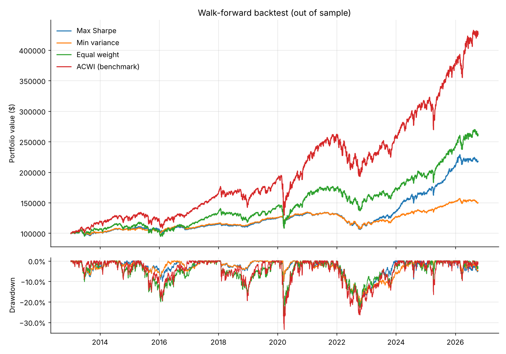

# Portfolio backtest summary

Out-of-sample period: 2013-01-07 to 2026-10-09 (13.7 years). Rebalanced every 21 trading days on a 756-day lookback, 5 bps trading cost.
Rules: long-only, at least 70% non-US, max 25% per ETF, $100,000 starting capital. Sharpe uses BIL as the risk-free rate.

## Results

|                          | Max Sharpe   | Min variance   | Equal weight   | ACWI (benchmark)   |
|:-------------------------|:-------------|:---------------|:---------------|:-------------------|
| CAGR                     | 5.8%         | 3.0%           | 7.2%           | 11.2%              |
| Volatility               | 7.0%         | 5.5%           | 12.5%          | 16.2%              |
| Sharpe                   | 0.61         | 0.26           | 0.49           | 0.63               |
| Sortino                  | 0.77         | 0.35           | 0.62           | 0.79               |
| Max drawdown             | -21.1%       | -20.5%         | -26.3%         | -33.5%             |
| Calmar                   | 0.28         | 0.15           | 0.28           | 0.33               |
| Final value ($)          | $217,851     | $149,823       | $261,421       | $428,198           |
| FX contribution (ann.)   | -0.6%        | -0.5%          | -1.0%          |                    |
| Avg turnover / rebalance | 6.1%         | 1.9%           | 1.3%           |                    |

FX contribution is the annualized return that came from currency moves on unhedged holdings (approximate fund currency mixes in `portfolio/config.py`).

## Target weights today

|      | Max Sharpe   | Min variance   | Equal weight   | Non-US   |
|:-----|:-------------|:---------------|:---------------|:---------|
| EFA  |              |                | 5.6%           | yes      |
| HEFA | 2.5%         | 3.5%           | 5.6%           | yes      |
| VGK  |              |                | 5.6%           | yes      |
| EWJ  |              |                | 5.6%           | yes      |
| DXJ  | 13.0%        | 4.4%           | 5.6%           | yes      |
| EWU  |              |                | 5.6%           | yes      |
| EWC  | 2.9%         |                | 5.6%           | yes      |
| EWA  |              |                | 5.6%           | yes      |
| EEM  |              |                | 5.6%           | yes      |
| INDA |              | 2.6%           | 5.6%           | yes      |
| EWT  | 1.7%         |                | 5.6%           | yes      |
| MCHI |              |                | 5.6%           | yes      |
| BNDX | 25.0%        | 25.0%          | 5.6%           | yes      |
| IGOV |              | 14.5%          | 5.6%           | yes      |
| EMB  | 25.0%        | 25.0%          | 5.6%           | yes      |
| SPY  |              |                | 5.6%           | no       |
| IEF  | 22.0%        | 25.0%          | 5.6%           | no       |
| GLD  | 8.0%         |                | 5.6%           | no       |

Non-US share: Max Sharpe 70%, Min variance 75%, Equal weight 83%

Dollar amounts on $100,000:

|      |   Max Sharpe |   Min variance |   Equal weight |
|:-----|-------------:|---------------:|---------------:|
| EFA  |            0 |              0 |           5560 |
| HEFA |         2460 |           3490 |           5560 |
| VGK  |            0 |              0 |           5560 |
| EWJ  |            0 |              0 |           5560 |
| DXJ  |        12970 |           4410 |           5560 |
| EWU  |            0 |              0 |           5560 |
| EWC  |         2860 |              0 |           5560 |
| EWA  |            0 |              0 |           5560 |
| EEM  |            0 |              0 |           5560 |
| INDA |            0 |           2570 |           5560 |
| EWT  |         1710 |              0 |           5560 |
| MCHI |            0 |              0 |           5560 |
| BNDX |        25000 |          25000 |           5560 |
| IGOV |            0 |          14540 |           5560 |
| EMB  |        25000 |          25000 |           5560 |
| SPY  |            0 |              0 |           5560 |
| IEF  |        22020 |          25000 |           5560 |
| GLD  |         7980 |              0 |           5560 |
